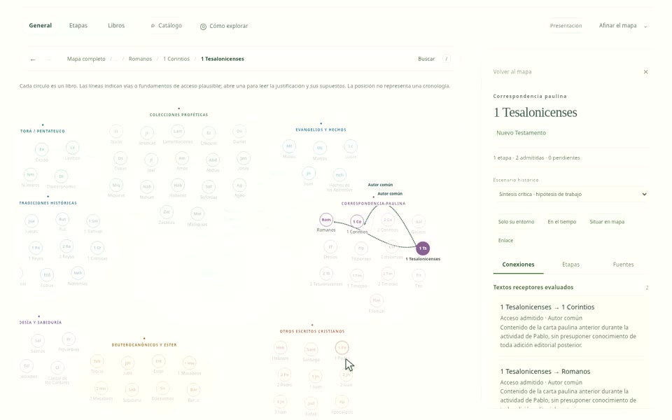
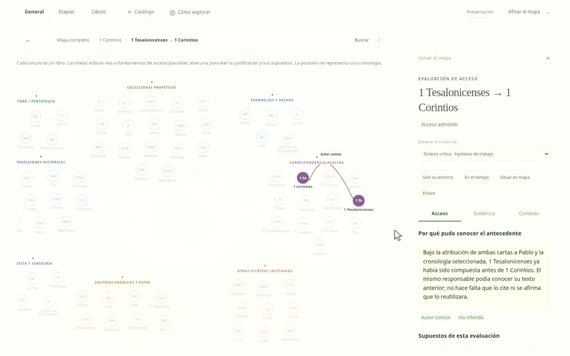

# Demostraciones del modo libre / Free atlas demonstrations

Grabaciones de la aplicación `v1.1.0-preview.2`, realizadas el 7 de octubre de 2026. Cada clip dura **20 segundos**, a **1440 × 900 píxeles y 30 fotogramas por segundo**, en MP4/H.264, sin audio. La interfaz de las grabaciones está en español. Las interacciones se realizaron sobre la aplicación; el cursor se hace visible para facilitar su seguimiento.

## Navegación por nodos

[Ver o descargar el clip de navegación por nodos](navegacion-nodos-20s.mp4).

Se abren directamente los círculos de Génesis, Deuteronomio, Isaías, Romanos, 1 Corintios y 1 Tesalonicenses. El mapa resalta las conexiones pertinentes y actualiza el detalle de cada libro. Un arrastre permite recorrer el grupo de las cartas paulinas. El orden de los clics representa el recorrido del usuario, no una cadena histórica de influencia.

## Exploración y evidencia

[Ver o descargar el clip de exploración y evidencia](exploracion-libre-20s.mp4).

El recorrido parte del inicio, busca 1 Corintios y abre la conexión desde 1 Tesalonicenses. Consulta la justificación por autoría común, las condiciones de acceso y las fuentes; después pasa a las etapas en el tiempo y abre su contexto. La evaluación conserva la atribución y cronología como supuestos y distingue acceso de reutilización efectiva.

## Conservación y verificación

Los MP4 y sus portadas se conservan en el repositorio. [manifest.json](manifest.json) registra la versión y el commit de la aplicación grabada, los instantes aproximados de las acciones, las propiedades de los vídeos y sus SHA-256. Las portadas son fotogramas de cada clip. La aplicación principal no necesita cargar estos archivos para funcionar.

Este avance documenta el estado actual del modo libre. La próxima prioridad de encuadre está registrada en las [notas de exploración](../exploracion.md). Las grabaciones no sustituyen las pruebas de interfaz ni una evaluación de usabilidad con participantes.

## English

These recordings document application `v1.1.0-preview.2` on 7 October 2026. Each clip lasts **20 seconds**, at **1440 × 900 pixels and 30 fps**, in MP4/H.264 without audio. The recorded interface is in Spanish. Actions were performed on the application, with a visible presentation cursor.

- [Node navigation](navegacion-nodos-20s.mp4): opens Genesis, Deuteronomy, Isaiah, Romans, 1 Corinthians and 1 Thessalonians directly from their circles, pans the map, and shows each book's connections and detail. Click order describes user navigation, not a historical influence chain.
- [Exploration and evidence](exploracion-libre-20s.mp4): starts from the home page, searches for 1 Corinthians, opens the connection from 1 Thessalonians, inspects common-authorship access reasoning and evidence, then switches to the timeline and context. Access remains distinct from actual reuse.

The videos and frame-derived poster images are stored here. [The manifest](manifest.json) identifies the recorded application commit, approximate action times, media properties and SHA-256 digests. They are documentation assets and are not loaded by the main application. See [the exploration notes](../exploracion.md) for the next framing priority. Recordings document the observed interface; they do not replace browser checks or participant usability research.
